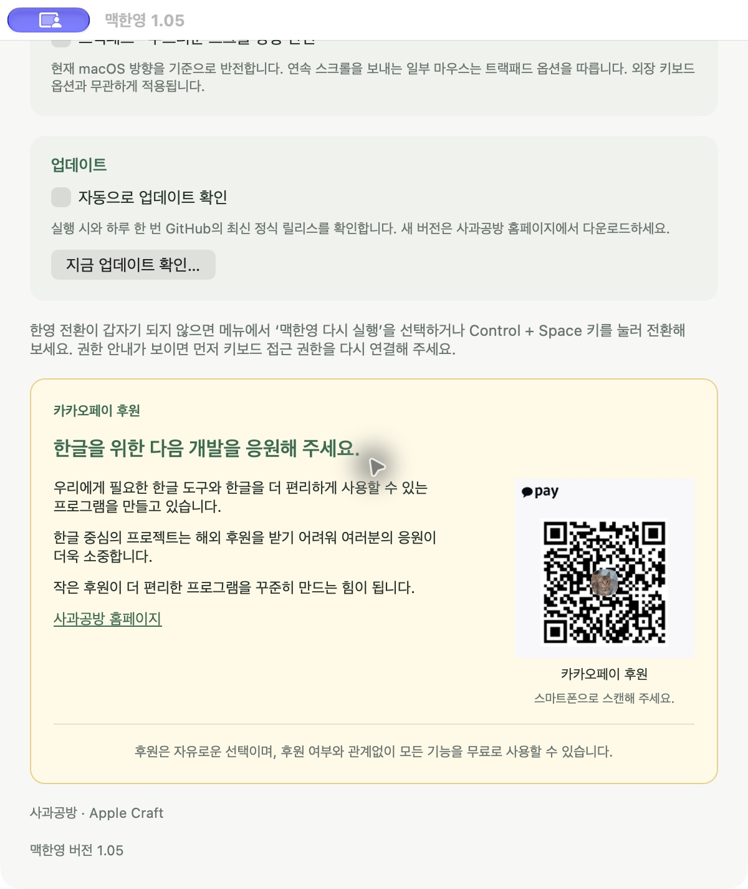

# 맥한영 · MacHanYoung 1.05
사과공방 · Apple Craft / 개발자 최귀동
© 2026 Apple Craft. All rights reserved.

macOS 13 이상, Apple Silicon 및 Intel. Karabiner 없이 동작합니다.

## 카카오페이로 후원하기

카카오톡의 코드스캔으로 아래 QR을 스캔하면 후원할 수 있습니다.


## 다운로드
[사과공방 홈페이지에서 맥한영 1.05 다운로드](https://applecraft.kr/?view=programs#app-machanyoung)

[최신 릴리스와 배포 파일](https://github.com/Choikuidong/MacHanYoung/releases/latest)

전체 소스는 이 저장소의 `MacHanYoung-1.05-Source.zip`에 포함되어 있습니다. 압축을 풀면 Sources, Resources, Scripts, Tests와 build.sh가 있습니다.

## 1.05 변경
- 설정 맨 아래에 원본 카카오페이 QR과 후원 안내 추가
- 한글 프로젝트의 다음 개발을 응원하는 문구와 홈페이지 링크
- 후원은 자유로운 선택이며 모든 기능은 무료
- 기존 키보드·한영·한자·특수문자·스크롤·업데이트 확인 기능 유지
- 표시 버전 1.05 · 내부 빌드 35



### 한글을 위한 다음 개발을 응원해 주세요.
우리에게 필요한 한글 도구와 한글을 더 편리하게 사용할 수 있는 프로그램을 만들고 있습니다.

한글 중심의 프로젝트는 해외 후원을 받기 어려워 여러분의 응원이 더욱 소중합니다.
작은 후원이 더 편리한 프로그램을 꾸준히 만드는 힘이 됩니다.

후원은 자유로운 선택이며, 후원 여부와 관계없이 모든 기능을 무료로 사용할 수 있습니다.

[사과공방 카카오페이 후원 안내](https://applecraft.kr/?view=support)

## 1.04 변경
- 메뉴와 설정에서 업데이트 확인
- 자동 확인 기본 ON, 실행 후 24시간 간격으로 GitHub 최신 정식 릴리스 확인
- 새 버전·변경 내용 알림, 같은 버전은 자동으로 반복 알림하지 않음
- 다운로드 안내는 https://applecraft.kr/?view=programs#app-machanyoung 으로 연결
- DMG 다운로드와 설치는 홈페이지 안내에 따라 사용자가 직접 진행
- 네트워크 오류·요청 제한·릴리스 미등록 안내, 오래된 버전으로의 다운그레이드 방지
- 1.04 / 내부 빌드 34

## 1.03 변경
- Win + ;와 Win + . 모두 같은 특수문자 창을 표시
- 사용자 제공 참고표의 1,038개 문자와 순서를 반영 (정규화하지 않음)
- 기본 자음 14개, 쌍자음 ㄲ·ㄸ·ㅃ·ㅆ 및 빈 ㅉ 범주
- Tab으로 전체 목록 펼치기/접기, 방향키 + Enter와 마우스 선택
- 작은 화면에서는 전체 목록을 스크롤할 수 있음
- 페이지 이동은 PageUp/PageDown 또는 이전/다음 버튼
- 버전 1.03 / 내부 빌드 33

## 1.02 변경
- 기존 설정 배치를 유지한 녹색 계열 UI
- 물리 Win + ; 단축키로 기호·이모지·이모티콘 선택
- 한국어 자음 + 오른쪽 Ctrl로 자음별 기호 선택
- 두 입력 방식 기본 ON, 각각 설정 가능
- 숫자 1–9·방향키·Enter·Esc와 Tab/PageUp/PageDown 지원
- 입력 기록·클립보드 사용 없이 선택 위치를 검증하고 삽입
- 표시 버전 1.02 / 내부 빌드 32

자음 변환은 AX 텍스트 범위를 제공하는 앱에서 동작합니다. 미지원 앱에서는 기존 한자 변환 옵션을 따릅니다.
1.03 문자표는 사용자 제공 참고표를 기준으로 합니다. Windows의 모든 버전과 모든 입력기에서 동일한 표시를 보장하지는 않습니다.
외장 키보드 한정 설정을 따르며, 암호·보안 입력에서는 사용할 수 없습니다.

## 시작하기
DMG의 맥한영.app을 응용 프로그램에 옮긴 뒤 실행합니다.
기존 앱을 먼저 종료하세요. 키보드 권한을 허용한 뒤 ‘Windows 사용자 추천 설정 적용’을 누릅니다.
Ctrl 단축키·키 배치·한영·한자 전환·로그인 자동 실행과 마우스 휠 반전을 켭니다.
팝업 선호는 보존하고 트랙패드 반전은 끕니다. 표준 기능 키 설정은 별도로 선택합니다.
세부 항목은 항상 표시됩니다. 창 가장자리를 드래그해 크기를 바꾸고, 스크롤해 아래 항목을 조정할 수 있습니다. 기존 사용자의 설정은 자동으로 덮어쓰지 않습니다.

## 스크롤 방향
현재 macOS 방향을 기준으로 반전합니다. 앱 종료 시 원래 방향으로 돌아옵니다.
일반 휠(비연속)과 트랙패드(연속) 이벤트를 구분합니다. 부드러운 스크롤을 보내는 일부 마우스와 Magic Mouse는 트랙패드 옵션을 따를 수 있습니다.
장치 모델을 식별하는 방식은 아닙니다. 외장 키보드 한정 옵션은 스크롤에는 적용되지 않습니다.

## 1.01 정정본
- 관하여 버전과 파일 버전을 1.01로 통일
- 사과공방 표기와 https://applecraft.kr/ 링크 추가

## 이전 기능 변경
- 모든 세부 설정을 항상 표시하고 접기/펼치기 제거
- 설정 창 크기 조절, 줄바꿈, 세로 스크롤 및 창 크기 기억
- 업데이트 후 기존 권한 요청 기록 때문에 새 권한 안내가 생략되는 문제 수정
- 키보드 권한 미연결 시 메뉴와 설정에 복구 절차 표시; 승인 후 입력 필터 자동 재시도
- 표시 버전 1.01, 내부 빌드 31

## 1.1 변경
- 추천 설정과 접고 펼치는 세부 설정, 작은 화면용 스크롤 지원
- 마우스·트랙패드 유형별 스크롤 반전, 가로·세로 및 관성 값 보존
- 앱 활성화 시 동기 장치 조회 제거, 변함없는 설정 UI/메뉴 재생성 생략
- 한영 전환 경로의 중복 소스 읽기와 설정 저장 제거
- 표시 버전 1.1, 내부 빌드 29

## 빌드 및 검사
macOS와 Xcode Command Line Tools가 필요합니다.
```sh
./build.sh
./맥한영.app/Contents/MacOS/WinKeys --self-test
./맥한영.app/Contents/MacOS/WinKeys --integration-test
./맥한영.app/Contents/MacOS/WinKeys --layout-test
swiftc -parse-as-library Sources/Preferences.swift Sources/ScrollTransformer.swift Tests/Scroll/main.swift -o /tmp/machanyoung-scroll-tests
/tmp/machanyoung-scroll-tests
```
팝업 검사는 앱 종료 후 `--popup-test`로 실행합니다.
통합 검사는 실제 입력 소스를 변경한 뒤 원래 소스로 복원합니다.
자동 검사만으로 모든 앱·물리 키보드·마우스의 실제 동작을 보증하지 않습니다.

## 업데이트 후 한영 전환이 안 될 때
현재 배포는 임시(ad-hoc) 서명으로, 파일이 바뀌면 macOS가 이전 키보드 권한을 새 실행 파일에 연결하지 않을 수 있습니다.
시스템 설정 → 개인정보 보호 및 보안 → 손쉬운 사용(macOS 27에서는 ‘기기 제어 및 데이터 접근’)에서 기존 맥한영 항목을 삭제한 뒤,
+ 버튼으로 /Applications/맥한영.app을 추가하고 켜세요. 승인 후 앱은 자동으로 입력 필터를 다시 시작합니다.
암호 입력은 macOS 창에서 직접 진행합니다. 권한을 우회하거나 보안 기능을 끄지 않습니다.

## 배포
유효한 Developer ID가 있으면 `MACHANYOUNG_SIGNING_IDENTITY`를 지정해 동일한 인증서로 계속 서명하세요.
외부 배포에는 별도 Apple 공증과 stapling이 필요합니다. 이 빌드에는 인증서나 비밀 키가 포함되지 않습니다.
임시 서명 빌드이며 Apple Developer ID 공증은 없습니다. 업데이트 후 기존 키보드 권한을 제거하고 새 앱을 다시 추가해야 할 수 있습니다.
GitHub에 소스를 올릴 때 이 폴더를 사용하고, DMG는 Releases 첨부 파일로 올리세요.
소스 공개와 오픈소스 라이선스 부여는 별개입니다. 별도 라이선스는 부여하지 않았습니다.
